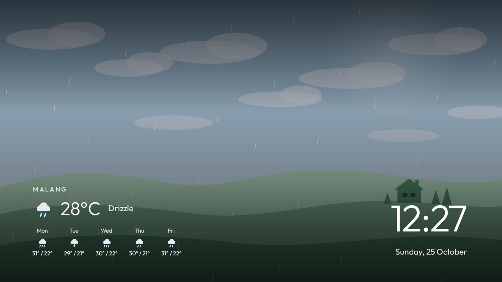

# Debloat TV Polytron dan Kustomisasi Homescreen

Hasil ngulik TV **Polytron PLD-43BAG9953** (based on Android TV 14 dengan RAM 1 GB) lewat ADB dari laptop Windows:
aplikasi pelacak dan iklan dimatikan, default Homescreen diganti dengan launcher sendiri yang ringan. 

> **Dijamin performa TV meningkat dan gak nge-lag.** Daftar paket dan skrip ini dibuat untuk TV Polytron, tapi seharusnya bisa juga untuk TV yang lain dengan OS Android. Selalu backup dulu, dan kerjakan sedikit demi sedikit.



## Isinya

- **Debloat:** 17 paket pelacak, iklan dan aplikasi bawaan yang tidak dipakai dimatikan (disable). Daftar dan alasannya:
  [debloat/debloat.txt](debloat/debloat.txt).
- **Launcher (Home) baru**, based on [cleanyourtv](https://github.com/Gathin23/cleanyourtv):
  - jam, tanggal, kalimat sapa/greetings dengan nama keluarga, dan cuaca kota di bawah jam (Open-Meteo);
  - jadwal sholat Kemenag yang ditampilkan di TV, waktu sholat yang sedang berjalan ditebalkan, plus hitung mundur jadwal
    sholat selanjutnya;
  - wallpaper lembah dan mengikuti cuaca asli (dari [tv-launcher](https://github.com/samipuro/tv-launcher));
  - dock aplikasi, menu turun untuk Inputs, Wi-Fi (daftar jaringan sekitar) dan Settings;
  - kartu **Now Playing** di atas dock saat musik diputar di Spotify, YouTube, dan lain-lain;
  - **screensaver** dengan wallpaper lembah, jam, cuaca dan prediksi cuaca selama 5 hari.
- **Add-on cuaca** layar penuh ([weather-addon](weather-addon)), dari cleanyourtv.
- **Skrip PowerShell** untuk backup, debloat, restore dan memasang launcher ([scripts](scripts)).

## Yang dibutuhkan

- Laptop Windows dengan [Android SDK Platform Tools](https://developer.android.com/tools/releases/platform-tools)
  (`adb.exe`), diekstrak ke `C:\platform-tools`.
- Android Studio (untuk build launcher; JDK bawaannya juga dipakai Gradle).
- Di TV: **Settings > System > About**, tekan *Build* 7 kali, lalu di **Developer options** nyalakan *USB debugging*
  dan *Network debugging*. Catat IP TV di **Settings > Network**.

Salin semua file di `scripts\` ke `C:\platform-tools` (satu folder dengan `adb.exe`), lalu dari PowerShell di folder itu:

```powershell
.\adb connect <IP-TV>:5555          # tekan Allow di TV
```

## Langkah

1. **Backup dulu.** `disable-batch.ps1` menolak jalan tanpa backup.
   ```powershell
   powershell -ExecutionPolicy Bypass -File .\backup.ps1
   ```
2. **Debloat per batch** (lihat [debloat.txt](debloat/debloat.txt)), cek TV setelah setiap batch:
   ```powershell
   powershell -ExecutionPolicy Bypass -File .\disable-batch.ps1 tv.anoki.acr.anokiacroptin com.google.android.feedback
   ```
   Skrip menolak paket inti Android dan semua `com.mediatek.*`, mengecek hasilnya, dan mencatat yang dimatikan ke
   `C:\tv-backup\disabled-by-us.txt`.
3. **Build launcher:** buka folder `launcher` di Android Studio, lalu *Build > Build APK(s)*. Atau dari PowerShell
   (set `JAVA_HOME` ke folder `jbr` Android Studio):
   ```powershell
   cd launcher; .\gradlew.bat assembleDebug
   ```
   Hasilnya `launcher\app\build\outputs\apk\debug\app-debug.apk`.
4. **Pasang dan jadikan Home** (launcher bawaan belum dimatikan, jadi masih ada jalan kembali):
   ```powershell
   powershell -ExecutionPolicy Bypass -File .\install-launcher.ps1 -Apk <path>\app-debug.apk
   powershell -ExecutionPolicy Bypass -File .\make-home.ps1
   ```
5. **Izin tambahan** (opsional):
   ```powershell
   # nama Wi-Fi di tombol Wi-Fi dan daftar jaringan
   .\adb shell pm grant com.gathin.tvhome android.permission.ACCESS_FINE_LOCATION
   # kartu Now Playing (hanya membaca sesi media, bukan isi notifikasi)
   .\adb shell cmd notification allow_listener com.gathin.tvhome/com.gathin.tvhome.MediaListener
   # screensaver Panda Home
   .\adb shell settings put secure screensaver_components com.gathin.tvhome/.AmbientDream
   ```
6. **Tema:** salin [theme/config.json](theme/config.json) ke TV. `"wallpaper": false` memakai lembah cuaca-hidup,
   `"dock_opacity": 70` membuat dock transparan.
   ```powershell
   .\adb push theme\config.json /sdcard/Android/data/com.gathin.tvhome/files/config.json
   ```
7. Setelah selesai, matikan *USB debugging* di Developer options.

## Mengatur launcher

Semua pilihan ada di [launcher/app/src/main/res/values/config.xml](launcher/app/src/main/res/values/config.xml).
Yang paling sering diubah:

| Pilihan | Isi |
|---|---|
| `latitude`, `longitude`, `weather_city` | lokasi untuk cuaca, jadwal sholat dan cuaca (default city: Malang) |
| `greeting_name` | nama setelah sapaan, misalnya "Good Morning, Panda Family" |
| `dock_apps` | aplikasi di dock, urut dari kiri |
| `dock_scale` | ukuran dock dalam persen (bawaan 85) |
| `weather_line`, `prayer_times`, `live_scene` | menyalakan atau mematikan cuaca, jadwal sholat dan lembah |

Setelah mengubah, build dan pasang ulang (langkah 3 dan 4).

**Wallpaper per hari** (opsional, menggantikan lembah): `theme/WallpaperGen.java` membuat 21 gambar, 3 per hari.
Jalankan `java WallpaperGen.java out`, salin tiap folder hari ke
`/sdcard/Android/data/com.gathin.tvhome/files/wallpapers/<hari>/` (satu file per `adb push`), lalu di
`config.json` hapus `"wallpaper": false`. Foto sendiri juga bisa ditaruh di folder hari itu.

## Mengembalikan

| Apa | Caranya |
|---|---|
| Satu aplikasi | `.\adb shell pm enable <paket>` |
| Semua yang dimatikan skrip | `powershell -ExecutionPolicy Bypass -File .\restore.ps1` |
| Paket yang di-uninstall untuk user | `.\adb shell cmd package install-existing <paket>` |
| Homescreen default | `.\adb shell pm enable com.google.android.tvlauncher`, lalu `.\adb shell cmd package set-home-activity com.google.android.tvlauncher/.MainActivity` |
| Screensaver Google | `.\adb shell settings put secure screensaver_components com.google.android.backdrop/.Backdrop` |

## Catatan dari TV ini

- `com.cltv.fast` dan `com.google.android.tvrecommendations` dihidupkan lagi oleh layanan TV (`com.mediatek.tv.service`,
  `com.at.factory.factorymanager`) setiap boot, jadi `pm disable-user` tidak cukup.
- **Jangan matikan `com.google.android.backdrop`**: itu screensaver Google. Tanpa screensaver, TV langsung tidur setelah
  5 menit diam.
- Di Android 14, `adb install` bisa menggantung menunggu konfirmasi di layar, jadi skrip memakai `adb push` lalu
  `pm install`.
- Screensaver tidak bisa dijalankan langsung lewat ADB (butuh root). Untuk mengujinya, biarkan TV diam 5 menit.

## Sumber dan lisensi

| Proyek | Yang dipakai | Lisensi |
|---|---|---|
| [cleanyourtv](https://github.com/Gathin23/cleanyourtv) oleh Gathin | dasar launcher dan add-on cuaca | MIT |
| [tv-launcher](https://github.com/samipuro/tv-launcher) oleh Sami Puro | lembah cuaca-hidup, Now Playing | MIT |
| [cosy-home-tv](https://github.com/oliverjwroberts/cosy-home-tv) oleh Oliver Roberts | dasar lembah di tv-launcher | MIT |
| [CleanXiaomiTV](https://github.com/majnioui/CleanXiaomiTV) | pembaca sesi media di balik Now Playing | MIT |
| [Outfit](https://github.com/Outfitio/Outfit-Fonts) | huruf launcher | OFL 1.1 |
| [Open-Meteo](https://open-meteo.com) | data cuaca | CC BY 4.0 |

File lisensinya ada di [licenses](licenses). Bagian buatan sendiri: [MIT](LICENSE).
